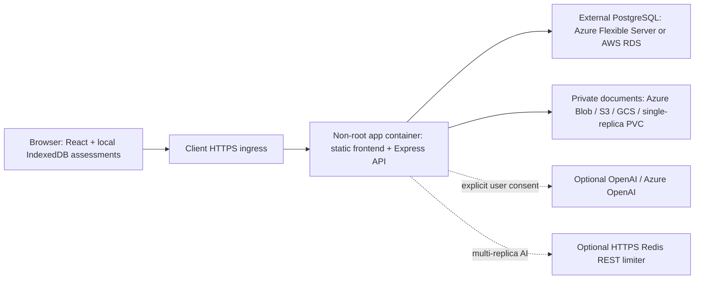

# Clean Core Assessment: client Kubernetes handoff

This package prepares deployment; it does not provision a cluster, push an image,
transfer existing data, or deploy automatically. See ANALYSIS.md for exact
verification results and ENV-VARIABLES.md for configuration.

## Architecture and data boundaries



Local Admin/Developer/Reviewer accounts, permissions, session revocation and
password changes are preserved. There is no Replit Auth/OIDC migration.
RDS is a **database alternative, not file storage**: accounts, sessions, audit
and knowledge/template metadata use PostgreSQL; uploaded bytes use private
object storage. Assessments/recovery remain in each browser; back them up
using the application's existing workspace export.

Replit continues using separate Vite and API services. CC_STATIC_DIR opts into
the client single-container frontend; leave it unset on Replit. The image is
built for host-root `/`; existing Replit BASE_PATH builds are unchanged. A
client subpath ingress deployment is not supported by this root-path image;
use a dedicated host without prefix rewriting. `/api` misses return JSON,
not index.html. Hashed assets, fonts, WASM and lazy exports come from the build.

## Prerequisites and sizing

- Chart accepts Kubernetes 1.28–1.35 API versions (not a certification of every
  distribution/version). Use a client-supported version, Helm 3.16+,
  an ingress controller and metrics-server if HPA is enabled.
- DNS, TLS certificate and registry. cert-manager is optional; existing TLS
  Secrets also work. Restrict access to the app Service to the ingress layer.
- Existing namespace, private DB networking, private object storage, secret
  delivery, workload identity and imagePullSecrets where required.
- Start at 250m CPU/512 MiB requested, 2 CPU/2 GiB limit per app pod.
  Parser/report workers add memory; benchmark real document size/concurrency.
  One replica is dependency-light; two gives availability with cloud storage.
  Local storage is strictly one process/replica and uses Recreate updates.
- HPA or multiple AI replicas require `CC_AI_LIMITER=redis-rest` plus
  URL/token/namespace. This protocol accepts Redis commands over HTTPS;
  raw Redis TCP is **not** a drop-in dependency. No quota is spent by probes.
- Capacity budget: `HPA max × CC_DB_POOL_MAX + migration(3) + admin/backup
  headroom` must remain below database connection limits. Allow a rolling
  deployment surge pod as well. App role needs no schema ownership.

## Build and local Compose

```sh
docker build --platform linux/amd64 -t registry.example.com/clean-core:1.0.0 .
cp deploy/.env.example deploy/.env
# Edit deploy/.env locally with unique test values; do not commit it.
docker compose -f deploy/docker-compose.yml --env-file deploy/.env up --build -d
curl --fail http://localhost:8080/health
curl --fail http://localhost:8080/ready
docker compose -f deploy/docker-compose.yml --env-file deploy/.env logs app
```

Open http://localhost:8080, sign in as admin with the initial bootstrap password,
and change it. Compose's localhost binding explicitly sets CC_COOKIE_INSECURE
and CC_DB_ALLOW_PLAINTEXT; these exceptions are not for HTTPS production.
Use URL-safe POSTGRES_PASSWORD characters (or percent-encode in DATABASE_URL
when managing your own connection URL). Named volumes persist PostgreSQL and
local documents across restarts. `down` retains them; `down -v` permanently
deletes this local test data. Do not use it on valuable data.

On Apple Silicon, keep `--platform linux/amd64`; this workspace lock deliberately
excludes several ARM build-tool binaries. Multi-architecture images need a
separate reviewed dependency/platform build.

## Secrets, roles and migration ordering

Create runtime and migration identities separately. On a fresh database, the
migration role needs CONNECT and CREATE on the target schema and must own the
tables it creates. Run the image's `node dist/migrate.mjs` using its dedicated
DATABASE_URL before starting the app. The migration is additive, transactional,
serialized and noninteractive; it initializes all current account, session,
audit, throttle, knowledge, cleanup and template schemas. It never uses
drizzle push --force. Back up before every upgrade.

After schema initialization, grant runtime CONNECT/USAGE plus
SELECT/INSERT/UPDATE/DELETE on the app tables. Configure migration-role default
privileges for future tables. This application uses no application sequences.
For example, adapt role/schema names under DBA control:

```sql
GRANT CONNECT ON DATABASE clean_core TO clean_core_app;
GRANT USAGE ON SCHEMA public TO clean_core_app;
GRANT SELECT, INSERT, UPDATE, DELETE ON ALL TABLES IN SCHEMA public TO clean_core_app;
ALTER DEFAULT PRIVILEGES FOR ROLE clean_core_migrator IN SCHEMA public
  GRANT SELECT, INSERT, UPDATE, DELETE ON TABLES TO clean_core_app;
```

Set CC_SCHEMA_BOOTSTRAP=false so the app does not run legacy optional DDL.
Bootstrap admin creation is ordinary DML, not schema creation. Unset its
password after first setup; do not rotate an existing account by changing
CC_BOOTSTRAP_PASSWORD.

Use existingSecret=clean-core-runtime containing DATABASE_URL, SESSION_SECRET,
initial CC_BOOTSTRAP_PASSWORD and any AI/limiter credentials. The chart injects
DATABASE_URL using secretKeyRef, never a ConfigMap. The optional inline Secret
is intended only for approved tooling; Helm stores supplied values/release
history, so avoid passing secrets with `--set`.

Optional hooks use a **pre-existing** clean-core-migration Secret and service
account. These must be created by client tooling **before** Helm starts;
ordinary chart resources do not exist yet during pre-install hooks. CA
ConfigMaps and image-pull Secrets must also pre-exist. Hooks do not depend on
the app ConfigMap or app service account. External Secrets/CSI synchronization
must finish before enabling the hook.

## AWS profile: RDS + S3

Use values-aws.yaml together with values-prod.yaml as appropriate. No
in-cluster PostgreSQL database or AWS infrastructure is installed.

1. Obtain the client RDS PostgreSQL endpoint, port, database, role credentials
   and the official regional/global AWS RDS CA trust bundle over an approved
   channel. Independently verify the CA source. Store CA PEM in the pre-existing
   `rds-ca-bundle` ConfigMap under `ca.pem`. CA certificates are not credentials.
2. Supply DATABASE_URL through runtime/migration Secrets. With CC_DB_CA_FILE,
   omit URL `sslmode`, `sslrootcert`, `sslcert`, `sslkey` overrides: the app
   enables hostname/chain verification with rejectUnauthorized=true.
   URL `ssl` and `uselibpqcompat` options are always rejected. Without a CA
   file, safe sslmode=require/verify-ca/verify-full values are normalized to
   explicit hostname/chain verification before pg parses the connection.
   The effective pg TLS configuration is also checked before connecting.
   Never use NODE_TLS_REJECT_UNAUTHORIZED=0 or sslmode=no-verify.
3. The client cluster must resolve the private RDS hostname and route into
   its VPC (peering, transit gateway, VPN or same VPC). RDS security groups
   permit the actual node/pod source on configured PostgreSQL port (5432
   by default); network ACLs and return routes must also allow traffic.
4. Set S3 bucket/region/optional HTTPS endpoint independently from RDS.
   Require bucket versioning **Enabled**, Block Public Access, TLS-only
   policy and client-managed encryption (SSE-S3 or SSE-KMS). SDK credentials
   come from IRSA/Pod Identity where possible. IRSA service-account annotation
   is exemplified; the client must create the role/trust and webhook/agent.
   Non-EKS clusters can use approved OIDC federation or a short-lived
   credential broker. Static IAM keys in Secrets are a last-resort rotated
   alternative, never image/chart credentials.
5. Least privilege: bucket GetBucketVersioning, ListBucket constrained to
   `documents/private/*`; object GetObject/GetObjectVersion, PutObject,
   DeleteObjectVersion on `arn:aws:s3:::BUCKET/documents/private/*`.
   Add KMS GenerateDataKey/Decrypt only if SSE-KMS requires it. Separate
   provisioning permission from runtime permission; runtime does not change
   versioning, public access, lifecycle or encryption.
6. Reads pin native S3 VersionId and ETag. Cleanup enumerates at most 50
   current keys, snapshots their native versions and deletes exactly those
   versions; it never pretends an ETag is a GCS generation. New backends
   use create-only UUID staging/sealing and do not reuse object paths.
   Existing S3-compatible products must implement these semantics and pass
   the contract/integration tests before approval.
7. The API brokers signed uploads for S3/Azure/local backends; browsers upload
   only to the app host, so cloud bucket CORS is not needed for this mode.
   Replit/native GCS still use direct signed PUT URLs and require the existing
   storage/browser CORS policy for the exact application origin.
8. Client tooling may synchronize AWS Secrets Manager into existing Kubernetes
   Secrets; Secrets Manager is not mandatory. The app never reads it directly.

Rotate RDS CA bundles before certificate expiration, overlap old/new trust
during transition, update the ConfigMap and explicitly roll out/restart app
and future migration pods. Verify /ready and a real transaction after rotation.
CA ConfigMap changes are not automatically part of the app config checksum.
S3 lifecycle is client-owned: do not expire active sealed files; define
noncurrent-version retention, abandoned upload cleanup, backups and legal
holds deliberately. Real AWS connectivity needs a client-approved test account.

## Azure / native GCS / local storage

Azure uses DefaultAzureCredential with a private Blob container and conditional
ETag reads/deletes. Configure workload-identity service-account annotations and
pod labels as described in terraform/README.md. Credentials are never forwarded
to browsers. Replit and native GCS signed upload, generation pinning and
conditional cleanup are preserved.

Local mode is explicit, never a fallback after cloud failure. Mount a durable
PVC at CC_STORAGE_LOCAL_DIR=/data. The directory must be writable by the
runtime UID/group. Files have encoded validated keys and private permissions;
create-only publication uses fsync plus an atomic same-volume link. Hidden
publication staging records reside on that persistent filesystem (atomic
publication cannot cross a /tmp filesystem); they are not served. A crash can
leave `.pending-*` records; remove only while the app is stopped after checking
they are unpublished. Parser/temp scratch uses /tmp. Do not run multiple pods
or processes against this backend; a shared-volume configuration has **not**
been tested or approved. There is no automatic cloud-to-cloud data migration.

## Install, verify, upgrade and rollback

After client approval, push with your registry's short-lived authentication:

```sh
docker push registry.example.com/clean-core:1.0.0
bash deploy/check-helm.sh
# Create namespace, runtime/migration secrets, CA ConfigMap, identity and TLS first.
helm upgrade --install clean-core deploy/helm/clean-core \
  --namespace clean-core -f deploy/helm/clean-core/values-prod.yaml \
  -f deploy/helm/clean-core/values-aws.yaml -f client-reviewed-values.yaml \
  --set migration.enabled=true \
  --set-string image.repository=registry.example.com/clean-core \
  --set-string image.tag=1.0.0 --atomic --wait --timeout 10m
kubectl -n clean-core get pods,jobs,ingress
kubectl -n clean-core logs deployment/clean-core-clean-core
curl --fail https://clean-core.example.com/health
curl --fail https://clean-core.example.com/ready
```

Verify login/password change, demo assessment, knowledge upload/process/retrieval,
personal DOCX upload/preview/activation/export and workspace reload. Test both
Developer and Reviewer permissions. No probe calls the LLM or writes user data.
An unconfigured optional storage/AI service is excluded from readiness;
an enabled failing critical service makes it fail without exposing details.

Upgrade by backing up DB/files, scanning a new immutable image, reviewing
schema compatibility and running the same command with a new tag. Monitor
probes/events and application logs. ConfigMap changes trigger pod rollout via
checksum. Existing Secret changes require an explicit rollout restart.

```sh
helm -n clean-core history clean-core
helm -n clean-core rollback clean-core PREVIOUS_REVISION --wait
helm -n clean-core uninstall clean-core
```

Helm rollback restores Kubernetes resources, **not database schemas or data**.
Only roll back to a schema-compatible image; restore a backup under a separate
approved recovery plan when needed. Uninstall keeps external DB/storage and
the chart's annotated local PVC. Deletion of any persistent data is a separate,
explicitly approved action. Retained PVCs may need manual adoption on reinstall.

## Egress and ingress

Allow only enabled dependencies; hostnames depend on client configuration:

| Destination | Protocol | Purpose |
|---|---|---|
| Client DNS resolvers | UDP/TCP 53 | Name resolution |
| RDS `*.rds.amazonaws.com` or Azure `*.postgres.database.azure.com` | TCP configured PostgreSQL port | DB; private routing required |
| `BUCKET.s3.REGION.amazonaws.com` / configured S3 endpoint | HTTPS 443 | Private documents |
| `sts.REGION.amazonaws.com` (or approved STS endpoint) | HTTPS 443 | Conditional AWS web identity exchange |
| EKS Pod Identity credential endpoint | platform-defined local/link-local | Only if that credential provider is used |
| `ACCOUNT.blob.core.windows.net` | HTTPS 443 | Azure documents, often private DNS endpoint |
| `login.microsoftonline.com` | HTTPS 443 | Azure workload identity exchange |
| `storage.googleapis.com`, `oauth2.googleapis.com`, `sts.googleapis.com`, `iamcredentials.googleapis.com` | HTTPS 443 | Native GCS, conditional identity/signing |
| `api.openai.com` or `RESOURCE.openai.azure.com` | HTTPS 443 | Optional consented AI |
| configured Redis REST host | HTTPS 443 | Optional shared limiter |
| `fonts.googleapis.com`, `fonts.gstatic.com` | browser HTTPS 443 | Existing UI Inter stylesheet/font; export fonts are bundled |
| registry/scanner/provider downloads | runner/node HTTPS 443 | Build/image pull/Terraform, not app traffic |

No SAP/email egress is needed. Key Vault/Secrets Manager egress belongs to the
client secret controller, not the app. Replit localhost:1106 is not a client
dependency.

NetworkPolicy defaults disabled. Enabling with empty ingress/egress denies
all traffic. Supply an ingress-controller namespace/pod selector and DNS
UDP/TCP rules, plus client-specific DB/storage/identity/LLM/limiter rules.
Standard Kubernetes NetworkPolicy cannot allow hostnames; use fixed private
CIDRs/endpoints or a reviewed CNI FQDN policy/egress proxy. Cloud public IP
ranges change; do not pretend one static example covers them. Migration jobs
need their own existing namespace egress policy.

## Security and operational notes

- TLS terminates at the client ingress; preserve Host and the real Origin.
  The API does not broadly trust X-Forwarded-* headers or forwarded identities.
  Cookies are Secure by default even behind TLS offload. CSRF requires
  same-origin plus the existing session token; uploads use short-lived
  path-bound HMAC capabilities with create-only writes.
- Upload ingress body limits must permit 18 MB assessment requests and 8 MiB
  document uploads; use at least 20 MB and suitable parser/report timeouts.
  Reverse proxy/WAF access logs must redact `/api/storage-upload/*` capability
  paths, cookies, authorization and query strings; app request logs redact them.
- stdout/stderr only in production; central collection/retention is client-owned.
  SIGTERM makes readiness fail, stops timers/listening and drains with a
  25-second deadline; chart grace is 30 seconds.
- Container drops capabilities, disables privilege escalation, uses non-root
  UID 1000 and read-only root, with writable emptyDir /tmp. No Docker socket
  or Replit sidecar is needed at runtime.
- OpenShift arbitrary UID: set securityContext.runAsUser/runAsGroup to null
  (omit them), use allowed namespace fsGroup or platform-managed PVC ownership;
  image files are world-readable/executable, /tmp is an emptyDir.
  Do not request privileged SCC. Verify PVC group write permissions, especially
  local backend. Cloud storage avoids durable filesystem permission issues.
- OpenAI uses a model identifier, Azure uses a deployment name and explicit
  API version. Existing approved HTTPS origin validation and redirect rejection
  remain. Custom reverse-proxy AI origins are not automatically trusted.
- Lock down namespaces and Secret readers; workload identity is not a reason
  to grant broad bucket/database/admin access. Review dependency licenses,
  Trivy results and SBOM before each release.

## Troubleshooting

- **CrashLoopBackOff:** inspect redacted logs; check migration completion,
  DATABASE_URL presence, schema grants, strong bootstrap password and required
  worker dependencies. Never print env/secrets for debugging.
- **ImagePullBackOff:** confirm immutable repository/tag, registry reachability
  from nodes and namespace imagePullSecrets.
- **/health passes, /ready fails:** DB routing/TLS/pool exhaustion, enabled
  storage permissions/versioning, or invalid/unreachable Redis REST limiter.
  Readiness gives no credential/internal error details by design.
- **Login 403 / cookies missing:** exact ingress Host/Origin and HTTPS; don't
  “fix” it by trusting all forwarded headers or disabling Secure in production.
- **Uploads fail:** body size/timeouts, storage role/prefix, SESSION_SECRET
  consistency between replicas, expired capability, S3 versioning, or GCS CORS.
- **PDF/DOCX failure:** verify read-only-root smoke and parser resources;
  restrictive CPU/memory may kill subprocesses. Do not grant them cloud secrets.
- **Migration hangs:** check concurrent migration advisory lock and role DDL
  permissions. The hook deadline fails visibly rather than force-applying.
